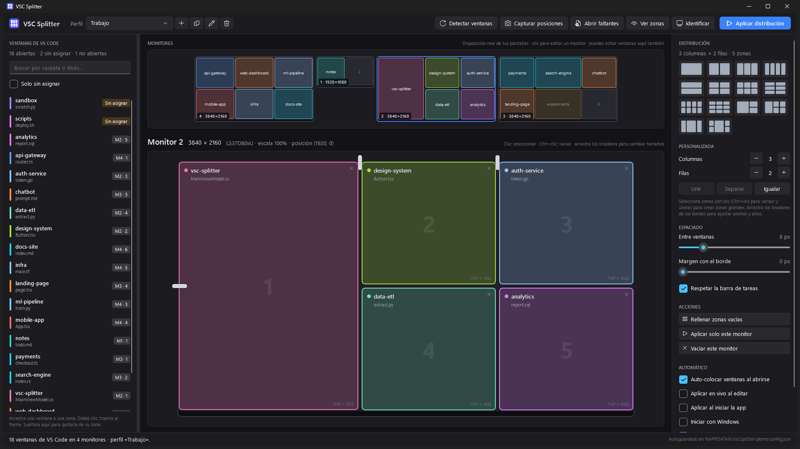

# VSC Splitter

**[English](#english)** · **[Español](#español)**



<sub>Screenshots use sample data · Capturas con datos de ejemplo — [docs/screenshots](docs/screenshots)</sub>

---

## English

Windows desktop app (C# · WPF · .NET 10) that arranges **Visual Studio Code** windows into zones on each monitor and places them **pixel-perfectly aligned**.

- Shows your monitors with their real position and resolution, just like *Settings > Display*.
- Each monitor has its own layout: presets (2, 3 and 4 columns, 2×2, 3×2, 3×3, main + sides…), custom rows and columns, grips to resize widths and heights, and merged zones.
- Drag and drop VS Code windows into zones; you can also move them from one zone to another (they swap places).
- **Aplicar distribución** (Apply layout) moves and resizes every window. It compensates for the 7 px invisible borders of Windows 10/11 windows, the usual reason why hand-placed windows don't line up.
- Profiles with autosave. Windows are recognized by their folder name, so a profile keeps working after closing VS Code or restarting the computer.

> The user interface is in Spanish. Button names are quoted as they appear in the app, followed by a translation.

### Requirements

- Windows 10/11
- [.NET 10 SDK](https://dotnet.microsoft.com/) (to build) or the .NET 10 Desktop Runtime (to run the published `.exe`)

### Build and run

```powershell
dotnet run --project src/VscSplitter.App          # development
dotnet test                                       # tests (zone logic, profiles, real placement)

# Single-file executable in .\publish (recommended for "Iniciar con Windows")
dotnet publish src/VscSplitter.App -c Release -r win-x64 --self-contained false -p:PublishSingleFile=true -o publish
```

### Usage

1. **First run.** The app assigns every open window to the zone it currently occupies. Review the zones and press **Aplicar distribución** (Apply layout) to align them.
2. **Pick a monitor** in the overview. In the right panel, choose a preset or adjust columns and rows.
   - Drag the white grips on the edges to change sizes.
   - Click a zone to select it; Ctrl+click selects several. **Unir** (Merge) combines the selected zones and **Separar** (Split) divides them again.
   - **Espaciado** (Spacing): pixels between windows and margin to the screen edge. *Respetar la barra de tareas* (Respect the taskbar) uses the monitor's work area.
3. **Drag** windows from the list on the left into a zone, either in the large editor or in the overview.
   - To remove a window from its zone, drop it back on the list or click the zone's ✕.
   - **Rellenar zonas vacías** (Fill empty zones) places all unassigned windows at once.
4. **Aplicar distribución** (Ctrl+Enter) moves all windows. **Aplicar solo este monitor** (Apply this monitor only) moves only the selected monitor's windows.
5. **Detectar ventanas** (Detect windows, F5) rescans windows and monitors. New windows appear as *Sin asignar* (Unassigned), ready to be dragged into the profile.

Other tools:

| Button | What it does |
|---|---|
| Capturar posiciones (Capture positions) | Assigns each window to the zone it currently occupies on screen |
| Ver zonas (Show zones) | Draws the zones on the real monitors (click-through) |
| Identificar (Identify) | Shows each monitor's number on its own screen |
| Abrir faltantes (Open missing) | Opens in VS Code the profile folders that are not open |

#### After a restart

- Each window is stored by its **folder name** (what VS Code shows in the title: `editor - folder - Visual Studio Code`). If a window closes, its zone keeps waiting for it and shows it dimmed as *no abierta* (not open).
- With **Auto-colocar ventanas al abrirse** (Auto-place windows when they open), a window goes to its zone by itself as soon as VS Code reopens that folder.
- **Abrir faltantes** (Open missing) reopens the missing folders. Their paths are read from `%APPDATA%\Code\User\globalStorage\storage.json`.
- **Iniciar con Windows** (Start with Windows) launches the app in the tray (`--tray`), so it places windows as soon as they appear. Publish the `.exe` to a fixed folder before enabling it.
- **Aplicar al iniciar la app** (Apply on startup), or the `--apply` argument, places everything when the app starts.
- When closed, the app keeps running in the tray (turn off *Al cerrar, seguir en la bandeja* to quit instead). The tray menu can apply the layout, open missing windows or exit.

#### Command line

| Argument | Effect |
|---|---|
| `--tray` | Starts hidden in the tray (used by *Iniciar con Windows*) |
| `--apply` | Applies the active profile at startup |
| `--config <file>` | Uses another configuration file (separate instance; handy for tests or demos) |

#### Shortcuts

| Key | Action |
|---|---|
| Ctrl+Enter | Apply layout |
| F5 | Detect windows |
| Ctrl+M | Merge selected zones |
| Del | Remove the windows from the selected zones |
| Esc | Clear selection |
| Ctrl+S | Save now (in addition to autosave) |

### Configuration

Everything is saved automatically to `%APPDATA%\VscSplitter\config.json`: profiles, per-monitor layouts, window assignments and options. Unexpected errors are logged to `error.log` in the same folder.

Monitors are recognized by their stable device path. If that does not match, they are matched by position and resolution and, as a last resort, by `\\.\DISPLAYn`. Use *Procesos a gestionar* (Managed processes) to add other VS Code-based editors such as `Cursor` or `Code - Insiders`.

### Project structure

```
src/VscSplitter.Core   Win32 (monitors, windows, DWM), zone engine, profiles, storage.json reader
src/VscSplitter.App    WPF UI (dark Fluent theme), drag & drop, overlays, tray icon
tests/                 xUnit: geometry, merge/split, profiles, titles, real placement with a test window
tools/New-AppIcon.ps1  Regenerates Assets/app.ico
```

### Known limitations

- If a VS Code window runs **as administrator**, the app must also run as administrator to move it (Windows blocks it otherwise).
- The window name comes from VS Code's default title. If you changed `window.title` or use named VS Code profiles, recognition may fail; drag the window to its zone again and the profile updates.
- Windows on other Windows virtual desktops are not detected.

### License

[MIT](LICENSE) © 2026 Christian Fonseca

---

## Español

App de escritorio para Windows (C# · WPF · .NET 10) que reparte las ventanas de **Visual Studio Code** en zonas de cada monitor y las coloca **alineadas al píxel**.

- Muestra tus monitores con su posición y resolución reales, igual que *Configuración > Pantalla*.
- Cada monitor tiene su propia división: plantillas (2, 3 y 4 columnas, 2×2, 3×2, 3×3, principal + laterales…), filas y columnas a medida, tiradores para cambiar anchos y altos, y zonas unidas.
- Arrastra y suelta las ventanas de VS Code en las zonas; también puedes moverlas de una zona a otra (se intercambian).
- **Aplicar distribución** mueve y redimensiona todas las ventanas. Compensa los bordes invisibles de 7 px de Windows 10/11, que son la causa típica de que las ventanas «no queden alineadas».
- Perfiles con autoguardado. Las ventanas se reconocen por el nombre de su carpeta, así que el perfil sigue sirviendo tras cerrar VS Code o reiniciar.

### Requisitos

- Windows 10/11
- [.NET 10 SDK](https://dotnet.microsoft.com/) (para compilar) o el runtime de escritorio de .NET 10 (para ejecutar el `.exe` publicado)

### Compilar y ejecutar

```powershell
dotnet run --project src/VscSplitter.App          # modo desarrollo
dotnet test                                       # tests (lógica de zonas, perfiles, colocación real)

# Ejecutable de un solo archivo en .\publish (recomendado para "Iniciar con Windows")
dotnet publish src/VscSplitter.App -c Release -r win-x64 --self-contained false -p:PublishSingleFile=true -o publish
```

### Uso

1. **Primera ejecución.** La app asigna cada ventana abierta a la zona que ocupa en ese momento. Revisa las zonas y pulsa **Aplicar distribución** para alinearlas.
2. **Elige un monitor** en la vista general. En el panel derecho, elige una plantilla o ajusta columnas y filas.
   - Arrastra los tiradores blancos de los bordes para cambiar tamaños.
   - Clic en una zona la selecciona; Ctrl+clic selecciona varias. **Unir** combina las zonas seleccionadas y **Separar** las vuelve a dividir.
   - **Espaciado:** píxeles entre ventanas y margen con el borde. *Respetar la barra de tareas* usa el área de trabajo del monitor.
3. **Arrastra** las ventanas desde la lista de la izquierda a una zona. Puedes soltarlas en el editor grande o en la vista general.
   - Para quitar una ventana de su zona, suéltala de nuevo en la lista o pulsa la ✕ de la zona.
   - **Rellenar zonas vacías** coloca de golpe las ventanas sin asignar.
4. **Aplicar distribución** (Ctrl+Enter) mueve todas las ventanas. **Aplicar solo este monitor** mueve solo las del monitor seleccionado.
5. **Detectar ventanas** (F5) vuelve a revisar ventanas y monitores. Las ventanas nuevas aparecen como *Sin asignar*, listas para arrastrarlas al perfil.

Otras herramientas:

| Botón | Qué hace |
|---|---|
| Capturar posiciones | Asigna cada ventana a la zona que ocupa ahora en pantalla |
| Ver zonas | Dibuja las zonas sobre los monitores reales (transparente a los clics) |
| Identificar | Muestra el número de cada monitor en su pantalla |
| Abrir faltantes | Abre en VS Code las carpetas del perfil que no están abiertas |

#### Después de reiniciar

- Cada ventana guarda el **nombre de su carpeta** (lo que VS Code pone en el título: `editor - carpeta - Visual Studio Code`). Si una ventana se cierra, su zona la sigue esperando y aparece atenuada como *no abierta*.
- Con **Auto-colocar ventanas al abrirse**, cuando VS Code vuelve a abrir esa carpeta, la ventana va sola a su zona.
- **Abrir faltantes** reabre las carpetas que falten. La ruta se obtiene de `%APPDATA%\Code\User\globalStorage\storage.json`.
- **Iniciar con Windows** arranca la app en la bandeja (`--tray`) para que coloque las ventanas en cuanto aparezcan. Antes de activarlo, publica el `.exe` en una carpeta fija.
- **Aplicar al iniciar la app** (o el argumento `--apply`) coloca todo al arrancar.
- Al cerrar, la app sigue activa en la bandeja (desactívalo con *Al cerrar, seguir en la bandeja*). Desde el menú de la bandeja puedes aplicar, abrir faltantes o salir.

#### Línea de comandos

| Argumento | Efecto |
|---|---|
| `--tray` | Arranca oculta en la bandeja (lo usa *Iniciar con Windows*) |
| `--apply` | Aplica el perfil activo al arrancar |
| `--config <archivo>` | Usa otro archivo de configuración (instancia independiente; útil para pruebas o demos) |

#### Atajos

| Tecla | Acción |
|---|---|
| Ctrl+Enter | Aplicar distribución |
| F5 | Detectar ventanas |
| Ctrl+M | Unir zonas seleccionadas |
| Supr | Quitar las ventanas de las zonas seleccionadas |
| Esc | Deseleccionar |
| Ctrl+S | Guardar ahora (además del autoguardado) |

### Configuración

Todo se guarda automáticamente en `%APPDATA%\VscSplitter\config.json`: perfiles, distribución por monitor, asignaciones y opciones. Los errores inesperados se registran en `error.log`, en la misma carpeta.

Los monitores se reconocen por su ruta de dispositivo estable. Si no coincide, se buscan por posición y resolución y, en último caso, por `\\.\DISPLAYn`. Con *Procesos a gestionar* puedes añadir otros editores basados en VS Code, como `Cursor` o `Code - Insiders`.

### Estructura

```
src/VscSplitter.Core   Win32 (monitores, ventanas, DWM), motor de zonas, perfiles, lectura de storage.json
src/VscSplitter.App    Interfaz WPF (tema Fluent oscuro), arrastrar y soltar, superposiciones, bandeja
tests/                 xUnit: geometría, unir/separar, perfiles, títulos, colocación real con una ventana de prueba
tools/New-AppIcon.ps1  Regenera Assets/app.ico
```

### Limitaciones conocidas

- Si una ventana de VS Code se ejecuta **como administrador**, la app también debe ejecutarse como administrador para poder moverla (Windows lo impide en caso contrario).
- El nombre de la ventana sale del título por defecto de VS Code. Si cambiaste `window.title` o usas perfiles de VS Code con nombre, el reconocimiento puede fallar. En ese caso, vuelve a arrastrar la ventana a su zona y el perfil se actualiza.
- Las ventanas que están en otro escritorio virtual de Windows no se detectan.

### Licencia

[MIT](LICENSE) © 2026 Christian Fonseca
